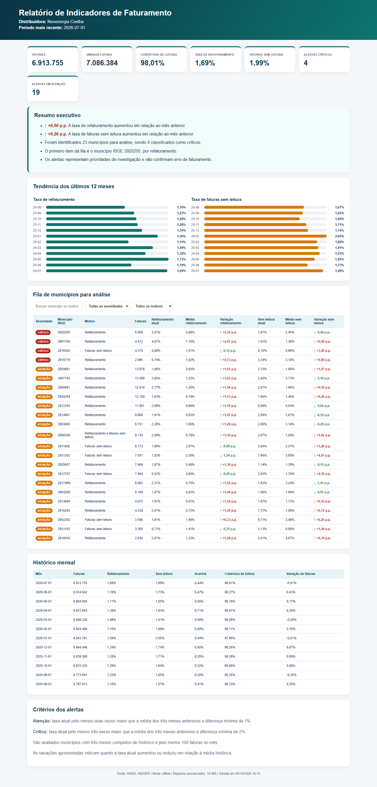
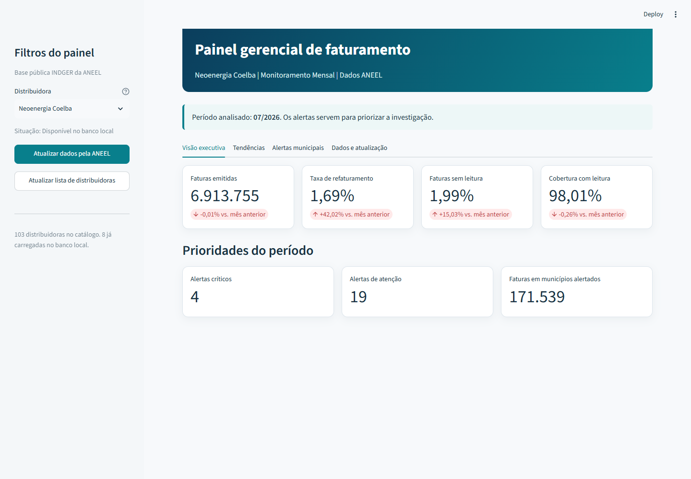

# Monitoramento e priorização de indicadores de faturamento

---

## Objetivo

O projeto busca automatizar a extração, o tratamento e o acompanhamento de indicadores como refaturamento, faturas sem leitura e cobertura de leitura de diferentes distribuidoras de energia do Brasil. O projeto transforma os dados públicos do INDGER, disponibilizados pela ANEEL, em duas entregas: um relatório HTML e um painel interativo em Streamlit.

O exemplo apresentado neste repositório usa a Neoenergia Coelba. A distribuidora pode ser alterada na execução.

## Fonte

Os dados vêm do conjunto [INDGER — Indicadores Gerenciais da Distribuição](https://dadosabertos.aneel.gov.br/dataset/indger-indicadores-gerenciais-da-distribuicao/resource/fd10c9d4-cb76-4020-a322-e79afb13eaf7), disponibilizado pela ANEEL. O pipeline consulta a API pública do portal e mantém um arquivo local para permitir novas execuções sem repetir o download.

## Resultados observados

No recorte mais recente do arquivo utilizado, referente a julho de 2026, foram processadas 6,9 milhões de faturas. A taxa de refaturamento foi de 1,69%, a taxa de faturas sem leitura ficou em 1,99% e a cobertura de leitura chegou a 98,01%.

Em relação ao mês anterior, o volume de faturas permaneceu praticamente estável, enquanto o refaturamento aumentou 0,50 ponto percentual e as faturas sem leitura aumentaram 0,26 ponto percentual. As regras priorizaram 23 municípios para análise, dos quais 4 foram classificados como críticos.

### Relatório HTML



### Painel em Streamlit



## Recomendações

As sugestões abaixo se referem exclusivamente ao exemplo da Neoenergia Coelba e ao recorte mais recente analisado, de julho de 2026, apresentado na visualização. Os alertas orientam uma investigação, mas não confirmam, isoladamente, falhas operacionais ou problemas de faturamento. Portanto, as recomendações representam possíveis ações baseadas no conhecimento do negócio e dependem de validação operacional.

1. **Priorizar a investigação dos municípios sinalizados:** começar pelos quatro municípios críticos e detalhar os 23 municípios priorizados por indicador, volume de faturas e variação em relação ao histórico. Os registros devem ser cruzados com ocorrências de leitura, ajustes de faturamento, rotas e equipes responsáveis para localizar as causas do aumento de 0,50 ponto percentual no refaturamento e de 0,26 ponto percentual nas faturas sem leitura.

2. **Executar um plano de recuperação das leituras:** nos municípios que concentram faturas sem leitura, replanejar rotas, realocar equipes e recuperar as leituras pendentes antes do próximo ciclo de faturamento. Em áreas com recorrência do problema, avaliar agendamento com o cliente, canais alternativos de autoleitura ou ampliação da medição remota.

3. **Implantar validações preventivas antes da emissão das faturas:** revisar as principais causas de refaturamento e criar bloqueios para contas com consumo atípico, ausência de leitura ou divergências cadastrais e tarifárias. Esses casos devem passar por conferência antes da emissão, reduzindo correções posteriores e o retrabalho operacional.

## Estrutura

```text
pipeline_criticidade_faturamento/
├── .streamlit/
├── data/
├── images/
├── logs/
├── outputs/
├── sql/
├── src/
├── .gitignore
├── dashboard_streamlit.py
├── pipeline_aneel.py
├── README.md
└── requirements.txt
```

---

## Regras

Os indicadores são calculados mensalmente por distribuidora. A taxa de refaturamento e a taxa de faturas sem leitura usam a quantidade de faturas do período como base.

Cada município é comparado com a média simples dos três meses-calendário anteriores. Apenas municípios com esse histórico completo e pelo menos 100 faturas no mês entram na avaliação:

- **Atenção:** taxa atual pelo menos duas vezes maior que a média, com aumento mínimo de 1 ponto percentual
- **Crítico:** taxa atual pelo menos três vezes maior que a média, com aumento mínimo de 2 pontos percentuais
- quando a média anterior é zero, os limites mínimos são 1% para atenção e 2% para crítico

A classificação organiza uma fila de investigação. Ela não confirma falha operacional nem erro de faturamento.

## Como executar

Crie e ative um ambiente virtual, depois instale as dependências:

```bash
python -m venv .venv
pip install -r requirements.txt
```

Na primeira execução, use o modo online para consultar a ANEEL e criar o banco e os arquivos de saída:

```bash
python pipeline_aneel.py --modo online
```

Depois disso, o mesmo recorte pode ser processado novamente no modo offline:

```bash
python pipeline_aneel.py --modo offline
```

Para abrir o painel:

```bash
streamlit run dashboard_streamlit.py
```

Outra distribuidora pode ser informada com `--distribuidora "Nome da distribuidora"`.

## Limitações

- Os resultados dependem dos dados declarados pelas distribuidoras e da atualização da fonte
- A fila mostra o código IBGE, sem o nome do município
- Os limites de alerta foram definidos para este projeto e precisam de validação de negócio antes de um uso operacional

## Próximos passos

- validar os limites de alerta com especialistas do processo;
- testar o comportamento com distribuidoras de portes diferentes;
- automatizar a execução periódica e o envio dos alertas.

